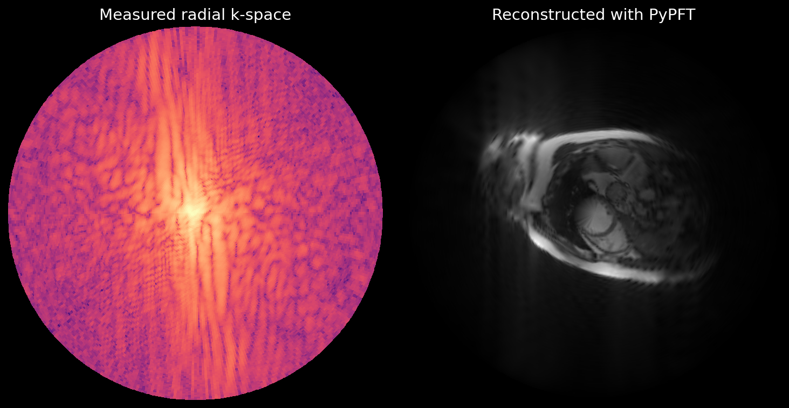
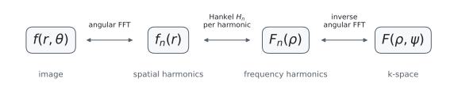
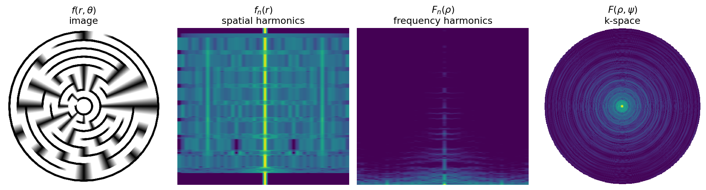

<h1 align="center">PyPFT</h1>

<p align="center"><b>The polar Fourier transform for Python: images and k-space sampled in polar coordinates, transformed without regridding.</b></p>

<p align="center">
  <a href="https://github.com/GhDamghani/PyPFT/actions/workflows/ci.yml"></a>
  <a href="https://github.com/GhDamghani/PyPFT/actions/workflows/tests.yml"></a>
  <a href="https://pypft.readthedocs.io"></a>
  <a href="https://pypi.org/project/pypft/"></a>
  <a href="https://pypi.org/project/pypft/"></a>
  <a href="https://github.com/GhDamghani/PyPFT/blob/main/LICENSE"></a>
  <a href="https://github.com/psf/black"></a>
  <a href="https://peps.python.org/pep-0561/"></a>
</p>

<p align="center">
  
</p>

Radial MRI, polar imaging and anything with circular symmetry produce data on spokes, not on a Cartesian grid. The usual answer is to regrid onto Cartesian pixels and run an FFT. PyPFT instead computes the **discrete polar Fourier transform** directly: an angular FFT, one discrete Hankel transform per harmonic, and an inverse angular FFT, following Baddour's and Yao & Baddour's formulation.

## Why PyPFT

- **A discrete Hankel transform for Python.** The DHT is the part no other Python package provides: Baddour's transform of any non-negative order, usable on its own, with a choice of implementations; the PFT handles negative harmonics through an exact sign identity.
- **Checked against the papers.** The forward and inverse transforms reproduce Yao & Baddour's published error figures to the paper's own precision, and a from-scratch kernel oracle certifies the fast pipeline matrix by matrix.
- **Two paths.** An exact, invertible discrete transform on its own sampling grid, and a ring-consistent route that approximates the continuous transform closely, directly from uniform polar data.
- **Measured data in.** Radial k-space lines are converted into PyPFT's polar layout, one sample or a batch of coils; the image above is reconstructed from a public cardiac dataset.
- **Built for use.** Batches of samples, a typed API (`py.typed`), validated inputs with clear errors, and ten executed tutorial notebooks.

## How it works

<p align="center">
  <picture>
    <source media="(prefers-color-scheme: dark)" srcset="https://raw.githubusercontent.com/GhDamghani/PyPFT/main/docs/_static/readme/pipeline_dark.svg">
    
  </picture>
</p>

Each step can be called on its own, and typed signal objects walk the chain one legal step at a time. Here a maze is carried through all four domains:

<p align="center">
  
</p>

## Installation

```bash
pip install pypft
```

PyPFT supports CPython 3.12, 3.13 and 3.14 on Windows, macOS and Linux.

## Quickstart

```python
import numpy as np
import pypft

# The transform's own polar sampling grid
grid = pypft.PolarGrid(n_radial=383, n_angular=15, R=40.0)

# A Gaussian sampled on that grid, in PyPFT's (radial, angular) layout
f = np.exp(-(grid.r.T**2))

# Forward and inverse polar Fourier transform
F = pypft.forward_pft(f=f, grid=grid)
f_reconstructed = pypft.inverse_pft(F=F, grid=grid)

# Show the spectrum as a disk
spectrum = pypft.PolarFrequencyAngularSignal(values=F, grid=grid)
pypft.render_cartesian(signal=spectrum, height=256, width=256)
```

## What's inside

| Module | What it does | Tutorial |
| --- | --- | --- |
| `pypft.dht` | The discrete Hankel transform | `03_discrete_hankel_transform` |
| `pypft.PolarGrid` | The transform's own sampling grid, with adequacy warnings | `02_sampling_grids` |
| `forward_pft`, `inverse_pft` | The exact discrete PFT and its inverse, single samples or batches | `05_pft_and_ipft`, `06_batches` |
| `forward_pft_ring`, `inverse_pft_ring` | The ring-consistent route to the continuous transform | `05_pft_and_ipft` |
| `PolarDomain`, signal classes | Typed signals that move along the chain | `04_domains` |
| `pypft.acquisition` | Radial k-space lines into the polar layout | `09_experimental_data` |
| `plot_signal`, `render_cartesian` | Figures for every domain | `08_visualization` |

The tutorials live in [`notebooks/`](https://github.com/GhDamghani/PyPFT/tree/main/notebooks), starting at `00_installation_and_quickstart`, and in the [documentation](https://pypft.readthedocs.io) with the user guide and API reference.

## Contributing

Issues and pull requests are welcome; [`CONTRIBUTING.md`](https://github.com/GhDamghani/PyPFT/blob/main/CONTRIBUTING.md) sets up a development copy in one step. Report security issues as described in [`SECURITY.md`](https://github.com/GhDamghani/PyPFT/blob/main/SECURITY.md).

## Citing

To cite PyPFT itself, use [`CITATION.cff`](https://github.com/GhDamghani/PyPFT/blob/main/CITATION.cff) (on GitHub, the "Cite this repository" button renders it as APA or BibTeX). PyPFT's transforms follow:

- Baddour, N. (2019). The Discrete Hankel Transform. In *Fourier Transforms - Century of Digitalization and Increasing Expectations*. IntechOpen. <https://doi.org/10.5772/intechopen.84399>
- Baddour, N. (2019). Discrete Two-Dimensional Fourier Transform in Polar Coordinates Part I: Theory and Operational Rules. *Mathematics*, 7(8), 698. <https://doi.org/10.3390/math7080698>
- Yao, X., & Baddour, N. (2020). Discrete Two-Dimensional Fourier Transform in Polar Coordinates Part II: Numerical Computation and Approximation of the Continuous Transform. *PeerJ Computer Science*, 6, e257. <https://doi.org/10.7717/peerj-cs.257>

The MR reconstruction application is based on:

- Golshani, S., & Nasiraei‐Moghaddam, A. (2017). Efficient radial tagging CMR exam: A coherent k‐space reading and image reconstruction approach. *Magnetic Resonance in Medicine*, 77(4), 1459-1472. <https://doi.org/10.1002/mrm.26219>

The cardiac image above is reconstructed from the MD-CNN radial cine dataset (El-Rewaidy et al., Harvard Dataverse, <https://doi.org/10.7910/DVN/CI3WB6>, CC0 1.0).

## License

BSD-3-Clause; see [`LICENSE`](https://github.com/GhDamghani/PyPFT/blob/main/LICENSE).
